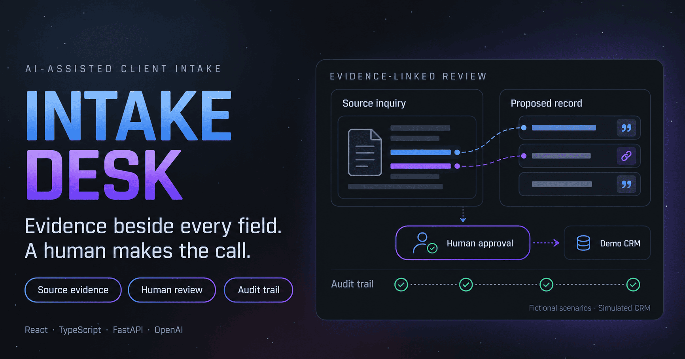

# Intake Desk

One inquiry. Exact quotes. Rules check, then a person decides.

## Demo

The two-minute demo and the write-up will be linked here once the review workspace is live. The opening beat is an inquiry that still needs a person: a missing phone number, an approaching deadline, or a name that overlaps with a current client. The same inquiry comes back as a proposed record, with the source words beside each field.

## The customer problem

An intake coordinator at a small law office gets a new inquiry by form or email. They copy the name, the dates, and the other party into a CRM, check whether a phone number is missing, and look for an obvious name overlap with a current client. A model that fills the form and writes the record would sound sure, and nothing would show where each value came from.

Intake Desk is a portfolio prototype of the review step:

Receive → Extract → Check → Review → Approve

The program proposes a structured record from fictional inquiry text and cites the source words. It does not give legal advice, accept a client, or write to a real CRM.

## What it does

- Stores the original inquiry text before any model call
- Extracts a typed record with a verbatim quote for each value
- Checks missing fields, urgent dates, and possible name overlaps in ordinary code
- Puts the source, the proposal, the warnings, and the evidence on one review screen
- Writes to a simulated CRM only after a person approves
- Scores the pipeline on 50 labeled fictional cases and publishes the misses

## Stack

| Layer | Choice | Why |
| --- | --- | --- |
| Front end | Next.js, React, TypeScript | The review queue and workspace |
| API | FastAPI | Stores the intake, runs the pipeline, and enforces the decision |
| Language | Python 3.12 | Extraction schema, checks, and evaluation live next to each other |
| Model | OpenAI Structured Outputs | One typed extraction call, not an agent loop |
| Database | SQLite locally, Postgres when deployed | Intakes, proposals, decisions, and run events |
| Checks | Ordinary Python | Missing fields, urgent dates, and possible name matches |
| Destination | Simulated CRM | Proves the write boundary without a real account |
| Evals | 50 labeled fictional cases | Grades extraction and warnings, including adversarial text |
